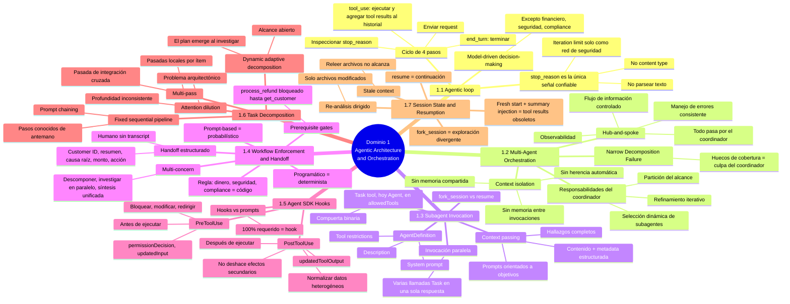
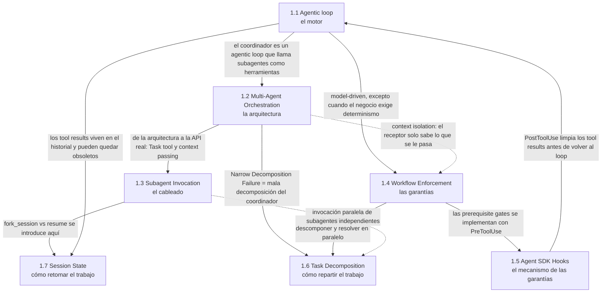

> [!note] En una frase
> El Dominio 1 describe cómo se construye un agente de principio a fin: un **agentic loop** controlado por `stop_reason` es el motor; un coordinador **hub-and-spoke** lo multiplica en subagentes aislados que solo saben lo que se les pasa; el **enforcement programático** (vía hooks `PreToolUse`/`PostToolUse`) pone garantías deterministas donde el modelo es probabilístico; la **decomposición** decide cómo se reparte el trabajo; y el **estado de sesión** decide cómo se retoma sin arrastrar contexto obsoleto.

## Mapa mental del módulo

## Cómo se relacionan los temas

Cada flecha es una dependencia conceptual: el tema de origen es la base o el "por qué" del tema destino.

### Lectura rápida de las relaciones

| Relación | Qué conecta | Idea puente |
|---|---|---|
| 1.1 → 1.2 | Loop → coordinador | Un coordinador es un agentic loop cuyo "tool" es invocar subagentes; cada subagente corre su propio loop. |
| 1.2 → 1.3 | Arquitectura → mecánica | 1.2 dice *qué* (hub-and-spoke, context isolation); 1.3 dice *cómo* (`Task`/`Agent` en `allowedTools`, metadata estructurada). |
| 1.1 → 1.4 | Model-driven → determinista | El loop deja que Claude elija herramientas, salvo en operaciones financieras, de seguridad o compliance: ahí manda el código. |
| 1.4 → 1.5 | Principio → implementación | Una prerequisite gate es, en concreto, un hook `PreToolUse` que deniega la llamada. |
| 1.5 → 1.1 | Hook → loop | `PostToolUse` normaliza el tool result *antes* de que se agregue al historial y Claude lo procese en la siguiente iteración. |
| 1.2 → 1.6 | Coordinador → decomposición | Los huecos de cobertura vienen de una decomposición demasiado estrecha; 1.6 da el criterio para descomponer bien. |
| 1.4 → 1.6 | Multi-concern → decomposición | Una solicitud con varios asuntos se descompone, se investiga en paralelo y se sintetiza. |
| 1.3 → 1.7 | fork_session → sesiones | 1.3 introduce `fork_session` vs `--resume`; 1.7 lo convierte en una matriz de decisión completa. |
| 1.1 → 1.7 | Historial → stale context | El loop exige agregar tool results al historial; ese mismo historial es el que se vuelve obsoleto al reanudar. |

## Hilos conductores del módulo

Estas ideas atraviesan varios temas. Si las tienes claras, muchas preguntas del examen se resuelven con el mismo razonamiento.

### 1. Determinista le gana a probabilístico cuando el fallo cuesta

- **1.1** — `stop_reason` (determinista) en vez de parsear texto (ambiguo).
- **1.4** — prerequisite gate en vez de un prompt "más fuerte".
- **1.5** — hook en vez de instrucción en el prompt cuando se necesita el 100%.
- **1.6** — cambiar la arquitectura (multi-pass) en vez de un mejor prompt o un modelo más grande.

> [!note] Analogía
> El cartel pide, el torniquete impide. En todo el módulo, la respuesta correcta ante un fallo "caro" es el torniquete.

### 2. El receptor solo sabe lo que le pasas

- **1.2** — context isolation: los subagentes no heredan nada del coordinador.
- **1.3** — sin metadata (URL, documento, página) el agente de síntesis no puede citar.
- **1.4** — el humano del handoff no ve el transcript: el resumen debe ser autocontenido.
- **1.7** — en un fresh start, el resumen inyectado es todo lo que el agente sabe del trabajo previo.

### 3. Una pregunta mecánica decide, no "qué tan importante es"

| Tema | Pregunta diagnóstica |
|---|---|
| 1.1 | ¿Qué dice `stop_reason`? |
| 1.4 | ¿Un solo fallo cuesta dinero, seguridad o compliance? |
| 1.5 | ¿Necesito actuar *antes* de que corra la herramienta o solo limpiar *después*? |
| 1.6 | ¿Conozco los pasos de antemano? |
| 1.7 | ¿El contexto previo es válido, quiero divergir, o los tool results están obsoletos? |

### 4. Arregla la causa raíz "arriba", no el síntoma "abajo"

- **1.2** — huecos de cobertura: el problema es la decomposición del coordinador, no los subagentes.
- **1.3** — citas faltantes: el problema es que el coordinador quitó la metadata, no el prompt del agente de síntesis.
- **1.6** — análisis inconsistente: el problema es la arquitectura de una sola pasada, no el modelo.
- **1.7** — consejos contradictorios: el problema es el historial obsoleto, no que falte releer archivos.

### 5. Paralelizar lo independiente

- **1.2** — partir el alcance entre subagentes para no duplicar trabajo.
- **1.3** — varias llamadas al Task tool en una sola respuesta.
- **1.4** — investigar cada asunto de una solicitud multi-concern en paralelo.
- **1.6** — pasadas locales por ítem, independientes entre sí, antes de la integración cruzada.

## Trampas transversales

> [!warning] Distractores que reaparecen en varios temas
> - **"Mejora el prompt" / "agrega few-shot"** → incorrecto en 1.4, 1.5 y 1.6 cuando se requiere garantía o el problema es estructural.
> - **"Agrega un iteration limit"** → solo red de seguridad en 1.1; no arregla una terminación prematura.
> - **"Agrega más subagentes" / "usa un modelo más grande"** → no arregla una mala decomposición (1.2) ni la attention dilution (1.6).
> - **"Que los subagentes se comuniquen directo"** → rompe hub-and-spoke (1.2).
> - **"Usa `PostToolUse` para bloquear"** → la acción ya ocurrió (1.5).
> - **"Haz `--resume` y relee los archivos" o "haz fork"** → el historial obsoleto sigue ahí (1.7).

## Temas del módulo

1. [[1 Agentic loop/1 resumen|1.1 Agentic loop]]
2. [[2 Multi-Agent Orchestration/1 resumen|1.2 Multi-Agent Orchestration]]
3. [[3 Subagent Invocation and Context Passing/1 resumen|1.3 Subagent Invocation and Context Passing]]
4. [[4 Workflow Enforcement and Handoff/1 resumen|1.4 Workflow Enforcement and Handoff]]
5. [[5 Agent SDK Hooks/1 resumen|1.5 Agent SDK Hooks]]
6. [[6 Task Decomposition Strategies/1 resumen|1.6 Task Decomposition Strategies]]
7. [[7 Session State and Resumption/1 resumen|1.7 Session State and Resumption]]
