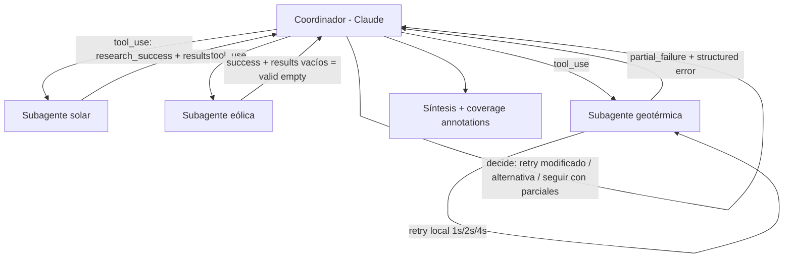

Aplicación práctica de [[1 resumen]] — un sistema de investigación multi-agente en Python donde los subagentes de búsqueda propagan errores estructurados a un coordinador (Claude, vía Messages API) que decide cómo recuperarse y produce una síntesis con `coverage annotations`.

## Escenario

Un coordinador recibe el tema *"renewable energy policy"* y lo divide en subtemas (solar, eólica, geotérmica, hidrógeno). Para cada subtema llama a un subagente de búsqueda (expuesto al coordinador como una tool). Algunas fuentes van a fallar a propósito: una hace timeout, otra devuelve 0 resultados legítimos, otra niega permiso.

Queremos aplicar **todo** el resumen:

1. `Structured error context` con los 4 elementos.
2. Distinguir `access failure` de `valid empty result`.
3. `Local recovery` (retry con backoff) en el subagente, propagando solo lo no resuelto.
4. Evitar `silent suppression` y `workflow termination`.
5. Coordinador que decide la recuperación y síntesis con `coverage annotations`.



## Paso 1 — Definir el schema del `structured error context`

Primero fijamos el "contrato" de lo que un subagente le devuelve al coordinador. Los 4 elementos del resumen son campos obligatorios cuando hay falla: `failureType`, `attemptedAction`, `partialResults`, `alternativeApproaches`. Además añadimos `shouldRetry`, que es la señal que separa `access failure` de `valid empty result`.

```python
from __future__ import annotations

from dataclasses import dataclass, field, asdict
from enum import Enum
from typing import Any, Literal


class FailureType(str, Enum):
    TRANSIENT = "transient"      # timeout, rate limit -> reintentable
    VALIDATION = "validation"    # input inválido -> reintentar igual no sirve, hay que corregir la query
    BUSINESS = "business"        # violación de regla de negocio
    PERMISSION = "permission"    # acceso denegado -> reintentar igual no sirve


Status = Literal["success", "partial_failure", "error"]


@dataclass
class SubagentResult:
    status: Status
    attemptedAction: dict[str, Any]                 # qué se intentó: tool, query, parámetros
    results: list[dict] = field(default_factory=list)
    message: str = ""
    shouldRetry: bool = False
    # --- solo cuando hay falla ---
    failureType: FailureType | None = None
    partialResults: list[dict] = field(default_factory=list)
    alternativeApproaches: list[str] = field(default_factory=list)

    def to_dict(self) -> dict:
        d = asdict(self)
        if self.failureType:
            d["failureType"] = self.failureType.value
        return d
```

> [!note] Por qué un schema y no un string
> Si el contrato fuera `return "error: search unavailable"`, el coordinador no tendría forma de saber qué query falló, qué se alcanzó a recuperar ni qué hacer después. El schema obliga a que cada falla llegue con la información para **decidir**.

## Paso 2 — El subagente distingue `access failure` de `valid empty result`

Esta es la distinción que el examen evalúa directamente. La regla:

- Si la herramienta **no pudo ejecutar la query** (timeout, conexión, permiso) → `access failure`, `status: "error"`.
- Si la query **se ejecutó y no hubo matches** → `valid empty result`, `status: "success"`, `results: []`, `shouldRetry: False`.

```python
class SourceTimeout(Exception): ...
class SourceConnectionError(Exception): ...
class SourcePermissionDenied(Exception): ...
class InvalidQuery(Exception): ...


def search_once(db_client, query: str, date_range: str) -> SubagentResult:
    """Un único intento de búsqueda, clasificando el resultado correctamente."""
    attempted = {"tool": "search_academic_db", "query": query, "dateRange": date_range}

    try:
        rows = db_client.search(query=query, date_range=date_range)
    except (SourceTimeout, SourceConnectionError) as e:
        # ACCESS FAILURE: la query NO se ejecutó -> vale la pena considerar retry
        return SubagentResult(
            status="error",
            failureType=FailureType.TRANSIENT,
            attemptedAction=attempted,
            message=f"Access failure: {e}",
            shouldRetry=True,
        )
    except SourcePermissionDenied as e:
        # ACCESS FAILURE no transitorio: reintentar igual no lo arregla
        return SubagentResult(
            status="error",
            failureType=FailureType.PERMISSION,
            attemptedAction=attempted,
            message=f"Permission denied: {e}",
            shouldRetry=False,
        )
    except InvalidQuery as e:
        return SubagentResult(
            status="error",
            failureType=FailureType.VALIDATION,
            attemptedAction=attempted,
            message=f"Invalid query: {e}",
            shouldRetry=False,  # hay que modificar la query, no repetirla
        )

    # La query SÍ se ejecutó. Cero filas es una respuesta válida, no un error.
    if not rows:
        return SubagentResult(
            status="success",
            attemptedAction=attempted,
            results=[],
            message="Query executed successfully. No matching records found.",
            shouldRetry=False,
        )

    return SubagentResult(status="success", attemptedAction=attempted, results=rows)
```

> [!warning] Trampa 4 en código — reintentar un vacío válido
> La forma ingenua de "ser robusto":
> ```python
> rows = db_client.search(query=query, date_range=date_range)
> if not rows:
>     raise SourceTimeout("empty result, probably failed")  # ❌
> ```
> Convierte un `valid empty result` en un `access failure` falso. El sistema reintenta (y quizá escala) una query que **siempre** va a devolver nada. Un vacío de una query exitosa **es la respuesta** — se reporta con `shouldRetry=False`.

## Paso 3 — `Local recovery`: retry con exponential backoff dentro del subagente

El subagente maneja sus propias fallas transitorias (1s, 2s, 4s) antes de molestar al coordinador. Detalles importantes:

- Solo se reintenta lo que tiene `shouldRetry=True` (transitorio). Permisos o validación no se reintentan igual.
- Se intenta también una **fuente de fallback** local.
- Los **resultados parciales se preservan** entre intentos (ej. páginas que sí se descargaron).
- Si nada funcionó, se propaga un **`structured error context` completo**, no un mensaje genérico.

```python
import time


def research_subtopic(primary_db, fallback_db, query: str, date_range: str) -> SubagentResult:
    partial: list[dict] = []
    delays = [1, 2, 4]
    last: SubagentResult | None = None

    # 1) Retry local con backoff sobre la fuente primaria
    for attempt, delay in enumerate([0] + delays):
        if delay:
            time.sleep(delay)
        last = search_once(primary_db, query, date_range)

        if last.status == "success":
            # Éxito (con o sin resultados). Si teníamos parciales de intentos previos, se combinan.
            last.results = partial + last.results
            return last

        # Preservar lo que el cliente alcanzó a traer antes de fallar (si lo expone)
        partial.extend(getattr(primary_db, "last_partial_rows", []))

        if not last.shouldRetry:
            break  # permiso / validación: reintentar igual es inútil

    # 2) Fallback local a otra fuente antes de escalar
    fb = search_once(fallback_db, query, date_range)
    if fb.status == "success" and fb.results:
        fb.results = partial + fb.results
        fb.message = "Primary source failed; results from fallback source."
        return fb

    # 3) No se pudo resolver localmente -> propagar STRUCTURED ERROR CONTEXT
    return SubagentResult(
        status="partial_failure" if partial else "error",
        failureType=last.failureType,
        attemptedAction={
            **last.attemptedAction,
            "attempts": len(delays) + 1,
            "fallbackTried": "government_publications",
        },
        partialResults=partial,
        message=last.message,
        shouldRetry=last.failureType == FailureType.TRANSIENT,
        alternativeApproaches=suggest_alternatives(last, query, date_range),
    )


def suggest_alternatives(last: SubagentResult, query: str, date_range: str) -> list[str]:
    """El subagente conoce su dominio: sugiere planes B concretos al coordinador."""
    if last.failureType == FailureType.TRANSIENT:
        return [
            "Retry with narrower date range (2023-2024)",
            "Use cached results from previous research session",
        ]
    if last.failureType == FailureType.PERMISSION:
        return ["Search open-access repository instead of licensed journals"]
    if last.failureType == FailureType.VALIDATION:
        return [f"Simplify query: '{query.split()[0]}'"]
    return []
```

> [!warning] Trampa 3 en código — retry "maduro" que termina en error genérico
> Es el distractor más tentador del examen (opción B de la Sample Question 8):
> ```python
> for delay in [1, 2, 4]:
>     try:
>         return primary_db.search(query=query, date_range=date_range)
>     except SourceTimeout:
>         time.sleep(delay)
> return {"status": "error", "message": "search unavailable"}  # ❌
> ```
> El backoff está bien; el problema es **lo que se propaga al final**. `"search unavailable"` oculta la query intentada, los resultados parciales y las alternativas. El coordinador queda ciego: no puede reintentar con query modificada ni seguir con parciales.

## Paso 4 — Los dos antipatrones que NO se implementan

Antes de construir el coordinador, vale la pena ver explícitamente las dos formas "fáciles" que el examen castiga.

> [!warning] Trampa 1 en código — `silent suppression`
> ```python
> def research_subtopic_bad(db, query, date_range):
>     try:
>         return {"status": "success", "results": db.search(query=query, date_range=date_range)}
>     except SourceTimeout:
>         return {"status": "success", "results": []}  # ❌ "para que el workflow siga"
> ```
> El coordinador ve "éxito, 0 resultados" y concluye que el tema no tiene literatura. No reintenta, no busca alternativas, y el reporte final **parece completo** aunque le falta una sección entera. Es el antipatrón más peligroso porque es **invisible**.

> [!warning] Trampa 2 en código — `workflow termination`
> ```python
> results = []
> for sub in subtopics:
>     results.append(research_subtopic_raising(sub))  # lanza SourceTimeout
> # ❌ una excepción en el 3er subtema -> se pierde el trabajo de los subtemas 1 y 2
> ```
> O peor: un `except Exception: sys.exit(1)` en el nivel superior. Cuatro subagentes terminaron bien y se descarta todo por uno. Es una respuesta **desproporcionada**.

En nuestra implementación, `research_subtopic` **nunca lanza excepciones hacia arriba**: siempre devuelve un `SubagentResult`, de éxito o de falla estructurada. Eso hace imposible tanto suprimir en silencio como tumbar el pipeline.

## Paso 5 — Exponer el subagente como tool y propagar el error al coordinador

El coordinador es Claude con una tool `research_subtopic`. El resultado del subagente se devuelve como un bloque `tool_result` (Messages API). Cuando hay falla se marca `is_error: true` y el `content` lleva el `structured error context` completo en JSON — así Claude recibe toda la información para decidir. Un `valid empty result` **no** se marca como error.

```python
import json
import anthropic

client = anthropic.Anthropic()
MODEL = "claude-sonnet-5-5"

TOOLS = [
    {
        "name": "research_subtopic",
        "description": (
            "Busca literatura académica sobre un subtema. Devuelve JSON. "
            "status='success' con results=[] significa que la búsqueda SÍ se ejecutó y no hay "
            "publicaciones: es una respuesta válida, no reintentar. "
            "status='error' o 'partial_failure' significa que la fuente no pudo consultarse: "
            "revisa failureType, attemptedAction, partialResults y alternativeApproaches "
            "para decidir cómo recuperarte."
        ),
        "input_schema": {
            "type": "object",
            "properties": {
                "query": {"type": "string", "description": "Query de búsqueda del subtema"},
                "date_range": {"type": "string", "description": "Rango de años, ej. '2022-2024'"},
            },
            "required": ["query", "date_range"],
        },
    }
]


def run_tool(name: str, tool_input: dict) -> dict:
    if name == "research_subtopic":
        result = research_subtopic(PRIMARY_DB, FALLBACK_DB, tool_input["query"], tool_input["date_range"])
        return {
            "content": json.dumps(result.to_dict(), ensure_ascii=False),
            # Solo las fallas reales son error. Un vacío válido NO lo es.
            "is_error": result.status != "success",
        }
    return {"content": json.dumps({"status": "error", "message": f"Unknown tool {name}"}), "is_error": True}
```

## Paso 6 — El coordinador decide la recuperación y sintetiza con `coverage annotations`

El `system prompt` le da al coordinador la política de recuperación (el "punto medio" entre suprimir y terminar) y le exige `coverage annotations` en la síntesis final. El loop es el agentic loop estándar: se sigue mientras `stop_reason == "tool_use"`.

```python
COORDINATOR_SYSTEM = """Eres el coordinador de un sistema de investigación multi-agente.

Divide el tema en subtemas y usa research_subtopic para cada uno (puedes llamar varias
tools en paralelo en una misma respuesta).

Política de recuperación ante fallas de un subagente:
- Nunca abandones toda la investigación por la falla de un subtema: conserva los
  resultados de los demás.
- Nunca trates una falla como si el subtema no tuviera información.
- failureType=transient: puedes reintentar UNA vez aplicando alguna de las
  alternativeApproaches (ej. rango de fechas más estrecho).
- failureType=permission o validation: no repitas la misma query; usa una alternativa
  o continúa con partialResults.
- status=success con results vacíos: es una respuesta válida. NO reintentes.

El reporte final DEBE terminar con una sección "Coverage" que liste cada subtema como:
- well-supported: hay hallazgos suficientes,
- limited: <motivo, ej. 'journal access unavailable; based on 1 partial result'>,
- no findings: la búsqueda se ejecutó y no hay publicaciones,
- unavailable: <motivo de la falla de acceso>.
Distingue siempre 'no findings' (vacío válido) de 'unavailable' (falla de acceso)."""


def coordinate(topic: str) -> str:
    messages = [{"role": "user", "content": f"Investiga: {topic}"}]

    while True:
        response = client.messages.create(
            model=MODEL,
            max_tokens=4096,
            system=COORDINATOR_SYSTEM,
            tools=TOOLS,
            messages=messages,
        )
        messages.append({"role": "assistant", "content": response.content})

        if response.stop_reason != "tool_use":
            return "".join(b.text for b in response.content if b.type == "text")

        tool_results = []
        for block in response.content:
            if block.type == "tool_use":
                out = run_tool(block.name, block.input)
                tool_results.append({
                    "type": "tool_result",
                    "tool_use_id": block.id,
                    "content": out["content"],
                    "is_error": out["is_error"],
                })
        messages.append({"role": "user", "content": tool_results})
```

Con las fuentes simuladas del escenario, el flujo queda así:

| Subtema | Lo que devuelve el subagente | Lo que decide el coordinador | Coverage final |
|---|---|---|---|
| Solar | `success`, 6 resultados | Usarlos | well-supported |
| Eólica | `success`, 4 resultados (vía fallback) | Usarlos | well-supported |
| Geotérmica | `partial_failure`, `transient`, 1 parcial, alternativas | Reintenta con rango 2023-2024; vuelve a fallar → sigue con el parcial | limited — *journal access unavailable* |
| Hidrógeno | `success`, `results: []` | **No reintenta** (vacío válido) | no findings |

Y el final del reporte se ve así:

```text
## Coverage
- Solar energy policy: well-supported (6 sources)
- Wind energy policy: well-supported (4 sources, from fallback database)
- Geothermal energy policy: limited — section based on 1 partial result due to
  unavailable journal access during research (timeout after 3 local retries and
  one coordinator retry with narrower date range)
- Hydrogen policy: no findings — search executed successfully, no matching
  publications in 2022-2024
```

> [!note] Qué demuestra este cierre
> - La geotérmica aparece como **limitación conocida**, no como tema irrelevante (`coverage annotations`).
> - El hidrógeno aparece como "no findings", **distinto** de "unavailable": el lector sabe que ahí sí se buscó.
> - Nada se perdió por la falla de un subagente (sin `workflow termination`), y nada se ocultó (sin `silent suppression`).

---
> [!tip] Sigue con este tema
> Vuelve a la teoría en [[1 resumen]], repasa con [[3 cuestionario]] y evalúate con [[4 test]].
