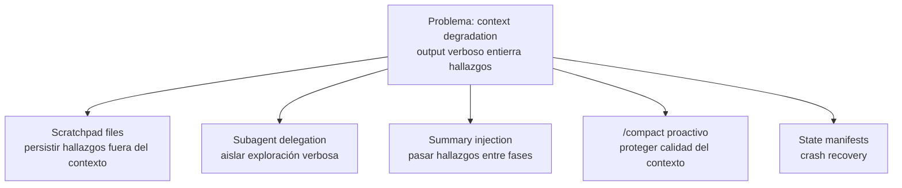

## Explícamelo como si tuviera 5 años

Imagina a una detective que tiene que revisar una mansión enorme de 200 cuartos buscando pistas.

Al principio todo va bien: entra al cuarto 1 y anota "la llave dorada está en el cajón izquierdo del escritorio". Pero sigue entrando a cuarto tras cuarto, y en cada uno le llegan montones de detalles: cada mueble, cada cajón, cada papel. Para el cuarto 40, tiene la cabeza tan llena de cosas recientes que cuando le preguntan por la llave dice: *"seguro está donde normalmente se guardan las llaves"*. Ya no recuerda **el cajón exacto** — solo recuerda "lo típico". Y no es que su cabeza se haya llenado: es que lo importante quedó **enterrado** bajo todo lo nuevo.

¿Cómo lo resuelve una detective profesional?

- **Libreta de notas (`scratchpad file`)**: desde el primer cuarto apunta lo importante en una libreta. Cuando le preguntan algo, **consulta la libreta**, no su memoria.
- **Ayudantes (`subagents`)**: en vez de revisar ella cada cuarto, manda ayudantes: "revisa el ala este y dime solo qué encontraste de importante". El ayudante se llena la cabeza de detalles; ella solo recibe el reporte corto.
- **Reporte de cambio de turno (`summary injection`)**: cuando empieza la segunda fase con otros ayudantes, les entrega un resumen de lo que ya se sabe, para que no vuelvan a revisar los mismos cuartos.
- **Ordenar el escritorio (`/compact`)**: de vez en cuando junta todos sus papeles sueltos en un resumen limpio — antes de que el desorden la abrume, no cuando ya no cabe nada.
- **Expediente de respaldo (`manifest`)**: guarda en un archivo fijo qué cuartos ya revisó, qué encontró y qué sigue. Si se va la luz y tiene que volver al día siguiente, abre el expediente y continúa donde se quedó.

> [!note] En una frase
> En exploraciones largas de un codebase, el modelo **pierde los detalles específicos** de lo que descubrió antes (no por falta de tokens, sino porque quedan enterrados bajo output verboso); se combate guardando hallazgos **fuera del contexto** (`scratchpad files`, `manifests`), **aislando** la exploración verbosa en `subagents`, inyectando resúmenes entre fases y usando `/compact` de forma proactiva.

## Argumento central

> La exploración de codebases grandes es una de las tareas que más contexto consume. En sesiones extendidas aparece un modo de falla específico: **`context degradation`** — el modelo deja de citar las clases, métodos y cadenas de dependencias concretas que descubrió y empieza a hablar de **"typical patterns"**. **No es un problema de límite de tokens**: es un problema de **calidad de atención** — los hallazgos precisos quedan enterrados bajo output verboso más reciente. Por eso la solución no es "más contexto", sino **gestionar qué vive en el contexto**: persistir hallazgos fuera de él, aislar la exploración verbosa y poder recuperarse de fallas sin perder el progreso.



## Ideas clave (Conclusiones)

### 1. `Context degradation` — qué es y por qué pasa

**El síntoma observable:**
- El modelo empieza a decir cosas como *"this follows the typical repository pattern"* en vez de *"the `OrderRepository` class at `src/repos/order.ts` implements the base `Repository<T>` interface with custom caching in the `findById` method"*.
- Da **respuestas inconsistentes** con lo que él mismo descubrió antes.

**El mecanismo (4 pasos):**
1. Cada paso de exploración genera **output verboso** (contenido de archivos, resultados de búsqueda, listados de directorios).
2. Ese output se **acumula** en el contexto de la conversación.
3. Los descubrimientos tempranos y precisos quedan **empujados hacia atrás**, mientras el output reciente domina.
4. La **atención del modelo se desplaza** a lo reciente y pierde las referencias específicas a lo anterior.

> [!important] El insight crítico
> `Context degradation` **no es un problema de token limit**. El modelo no se está quedando sin espacio — está perdiendo el rastro de los detalles. **Aumentar la ventana de contexto no lo arregla**: una ventana más grande también se llena de output verboso.

> [!note] Analogía mental
> Es como un escritorio: tener un escritorio más grande no te ayuda a encontrar el post-it importante si sigues apilando papeles encima. El problema no es el tamaño del escritorio, es lo que tapa al post-it.

### 2. `Scratchpad files` — la mitigación principal

- El agente **escribe los hallazgos clave en un archivo** y lo **consulta** para las preguntas siguientes.
- Persiste el conocimiento **fuera del contexto de la conversación**, así que es **inmune a la `context degradation`**.
- Cuando necesita recordar algo previo, **lee el scratchpad** en vez de depender del contexto.
- Debe contener **cosas específicas** (nombres de clases, rutas de archivo, cadenas de dependencias, hallazgos críticos), no generalidades.

> [!warning] Estrategia desde el inicio, no rescate
> El scratchpad es una **estrategia deliberada desde el principio** de cualquier sesión extendida de exploración — el agente debe tener instrucciones de mantenerlo desde el arranque, no recurrir a él cuando ya se degradó.

> [!example] Evidencia — scratchpad de la guía
> ```markdown
> # Exploration Scratchpad — Order Service
>
> ## Key Classes
> - `OrderRepository` (src/repos/order.ts) — implements Repository<T>, custom findById caching
> - `OrderService` (src/services/order.ts) — orchestrates OrderRepository + PaymentGateway
> - `RefundProcessor` (src/services/refund.ts) — depends on OrderService.getOrderWithItems()
>
> ## Dependency Chain
> RefundProcessor → OrderService → OrderRepository → PostgreSQL
> RefundProcessor → PaymentGateway → Stripe API
>
> ## Critical Findings
> - RefundProcessor has no retry logic for Stripe API failures
> - OrderRepository caches by orderId but cache invalidation on status change is missing
> - Test coverage: OrderService has 87% coverage, RefundProcessor has 12%
> ```

### 3. `Subagent delegation` — aislar la exploración verbosa

- Segunda gran mitigación: en vez de que el agente principal lea cada archivo y haga cada búsqueda (llenando su contexto), **delega preguntas específicas** a subagentes.
- Cada subagente tiene su **propio contexto aislado**: puede explorar de forma verbosa **sin contaminar** el contexto del agente principal.
- Devuelve un **resumen estructurado** al coordinador, que se queda solo con los hallazgos clave.
- El agente principal mantiene el contexto limpio para la **coordinación de alto nivel**.

> [!example] Evidencia — preguntas típicas para delegar (de la guía)
> - *"Find all test files for the order service and report their coverage status"*
> - *"Trace the refund flow from API endpoint to database and list all intermediate services"*
> - *"Identify all external API integrations and their error handling patterns"*

> [!important] El valor real es `context isolation`, no paralelización
> La lectura "obvia" es que los subagentes sirven para ir más rápido en paralelo. Pero en exploración de codebases, el **beneficio principal es el aislamiento de contexto**.

### 4. `Summary injection` entre fases

- Cuando la exploración va por fases (Fase 1: entender la arquitectura → Fase 2: investigar componentes específicos), **resume los hallazgos de la Fase 1 antes de lanzar los subagentes de la Fase 2**.
- **Inyecta ese resumen en el contexto inicial** (el prompt) de cada subagente de la Fase 2.
- Evita el problema de **"cold start"**: subagentes de la Fase 2 que **duplican** la exploración de la Fase 1 porque nadie les pasó los hallazgos previos.
- Además les da la **comprensión arquitectónica** necesaria para hacer las preguntas correctas.

> [!example] Evidencia — resumen de fase de la guía
> ```
> Phase 1 Summary (injected into Phase 2 subagent prompts):
> - The system follows a layered architecture: Controllers → Services → Repositories → Database
> - The refund flow passes through: RefundController → RefundProcessor → OrderService → PaymentGateway
> - Key concern: RefundProcessor has no retry logic for external API failures
> - Phase 2 objective: Investigate error handling in RefundProcessor and PaymentGateway
> ```

> [!note] Conexión
> Los subagentes **no heredan** el contexto del coordinador: lo que no se les pasa explícitamente en el prompt, no lo saben. Por eso la `summary injection` es necesaria.

### 5. `/compact` — usarlo de forma proactiva

- Comando de **Claude Code** para **reducir el uso de contexto** en sesiones extendidas.
- Cuando el contexto se llena de output verboso de descubrimiento (archivos, búsquedas, listados), `/compact` **resume la conversación** para liberar espacio **preservando la información clave**.
- Se usa **proactivamente** durante la exploración, **no solo al llegar al límite**.
- Su propósito es proteger la **calidad** del contexto, no solo la **cantidad**.

### 6. `Crash recovery` con `structured state manifests`

- Las sesiones largas pueden fallar por **crashes**, **interrupciones de red** o **agotamiento de contexto**. Sin mecanismo de recuperación, **se pierde todo el progreso**.
- Solución: **`structured state persistence`** — cada agente **exporta su estado** a una **ubicación conocida** (un **`manifest`**).
- Al reanudar (**on resume**), el **coordinador carga el manifest** y lo **inyecta en los prompts de los agentes**, que continúan donde se quedaron sin repetir exploración.

| Qué incluye el `manifest` | Para qué |
|---|---|
| Qué se ha explorado (archivos leídos, búsquedas hechas) | No repetir exploración |
| Hallazgos clave hasta ahora | No perder conocimiento |
| Fase actual y siguientes pasos | Saber dónde retomar |
| Preguntas pendientes / temas sin resolver | No olvidar cabos sueltos |

> [!example] Evidencia — manifest de la guía
> ```json
> {
>   "sessionId": "explore-order-service-001",
>   "phase": 2,
>   "exploredPaths": [
>     "src/repos/order.ts",
>     "src/services/order.ts",
>     "src/services/refund.ts"
>   ],
>   "keyFindings": {
>     "architecture": "Layered: Controllers → Services → Repositories → DB",
>     "criticalIssue": "RefundProcessor has no retry logic for Stripe API failures",
>     "testCoverage": {"OrderService": "87%", "RefundProcessor": "12%"}
>   },
>   "nextSteps": [
>     "Investigate PaymentGateway error handling",
>     "Review RefundProcessor test files",
>     "Check cache invalidation logic in OrderRepository"
>   ]
> }
> ```

> [!note] Scratchpad vs. manifest
> Ambos persisten cosas fuera del contexto, pero con propósito distinto: el **scratchpad** es la "libreta de trabajo" que el agente consulta **durante** la sesión para no degradarse; el **manifest** es el **estado estructurado** (qué se exploró, fase, next steps) que el **coordinador** carga para **reanudar** tras una falla.

### Mapa rápido: problema → mitigación

| Problema | Mitigación |
|---|---|
| Hallazgos tempranos se pierden en contexto verboso | `Scratchpad files` |
| El contexto del coordinador se llena de output de exploración | `Subagent delegation` (context isolation) |
| Subagentes de la Fase 2 repiten la Fase 1 ("cold start") | `Summary injection` en sus prompts |
| Contexto saturado de output de descubrimiento | `/compact` proactivo |
| Crash / red / agotamiento de contexto borra el progreso | `State manifests` cargados por el coordinador on resume |

## Trampas de examen

> [!warning] Trampa 1 — Aumentar la ventana de contexto para resolver la `context degradation`
> **El error:** pensar que si el modelo "olvida", es porque le falta espacio, y que una ventana más grande lo arregla. **Por qué falla:** la degradación no es por quedarse sin tokens; es el modelo perdiendo el rastro de detalles específicos a medida que se acumula output verboso. Una ventana más grande **también se llena** de output verboso. **Lo correcto:** `scratchpad files` (persistir hallazgos fuera del contexto) y `subagent delegation`.

> [!warning] Trampa 2 — Creer que `subagent delegation` es solo para paralelizar
> **El error:** justificar los subagentes únicamente por velocidad/paralelismo. **Por qué falla:** en exploración de codebases el beneficio **principal** es `context isolation` — el subagente absorbe el output verboso y el contexto del agente principal se queda limpio para coordinar. **Lo correcto:** delegar preguntas específicas para que el coordinador reciba solo resúmenes estructurados.

> [!warning] Trampa 3 — Reiniciar la sesión para "curar" la degradación sin guardar estado
> **El error:** abrir una sesión nueva y limpia (y quizás pedir "explora más eficientemente esta vez"). **Por qué falla:** reiniciar **pierde todo el conocimiento acumulado** y obliga a re-explorar. **Lo correcto:** persistir hallazgos en `scratchpad files` y `state manifests` **antes** de reiniciar, y luego **inyectarlos** en la nueva sesión.

> [!warning] Trampa 4 — Usar `/compact` solo al tocar el límite de contexto
> **El error:** tratar `/compact` como último recurso cuando el contexto ya se agotó. **Por qué falla:** para entonces la calidad del contexto ya se degradó. **Lo correcto:** usar `/compact` **proactivamente** durante sesiones extendidas para mantener la **calidad** del contexto, no solo la cantidad.

> [!warning] Trampa 5 — Precargar todo el codebase en el contexto inicial
> **El error:** "si le doy toda la estructura del codebase desde el inicio, tendrá menos que descubrir". **Por qué falla:** es el mismo error que la Trampa 1 disfrazado — llenas el contexto de volumen desde el arranque, que es justo lo que causa la degradación. **Lo correcto:** explorar de forma dirigida (subagentes con preguntas específicas) y persistir solo los hallazgos clave. *(Aparece como distractor en el escenario de práctica de la guía.)*

> [!info] Pregunta de muestra oficial
> `examguide.pdf` no incluye una Sample Question que corresponda 1:1 a este Task Statement (5.4). [[4 test]] usa preguntas propias construidas sobre el "Knowledge of" / "Skills in" de la Task Statement 5.4.

---
> [!tip] Sigue con este tema
> Repasa con [[3 cuestionario]], aplícalo en código en [[2 example]], y evalúate con [[4 test]].
