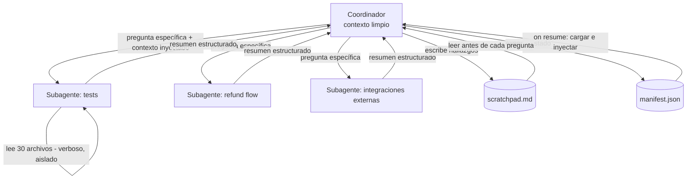

Aplicación práctica de [[1 resumen]] — un explorador de codebases "resistente a la `context degradation`" en Python: un coordinador que delega preguntas a subagentes (Claude vía Messages API, cada uno con su contexto aislado), mantiene un `scratchpad file`, inyecta resúmenes entre fases y guarda un `manifest` para `crash recovery`. Al final, el equivalente en una sesión interactiva de Claude Code con `/compact`.

## Escenario

Un equipo hereda un repositorio desconocido con un servicio de órdenes y reembolsos. Quieren entender la arquitectura (Fase 1) y luego investigar el manejo de errores del flujo de reembolsos (Fase 2). La exploración es larga: decenas de archivos, muchas búsquedas.

Queremos aplicar **todo** el resumen:

1. Evitar la `context degradation` sin "agrandar la ventana".
2. `Scratchpad file` desde el inicio, consultado antes de cada pregunta.
3. `Subagent delegation` para `context isolation` (no solo paralelismo).
4. `Summary injection` de la Fase 1 en los prompts de la Fase 2.
5. `Crash recovery` con un `manifest` que el coordinador carga on resume.
6. `/compact` proactivo en sesiones interactivas.



## Paso 1 — Herramientas de exploración (solo para subagentes)

Los subagentes son los únicos que tocan el código. Les damos tools de lectura (`read_file`, `grep`, `list_dir`) y una tool especial `report_findings` con la que **terminan** devolviendo un resumen estructurado. El coordinador **no** tiene estas tools: así es imposible que llene su propio contexto con output verboso.

```python
import json
import re
import subprocess
from pathlib import Path

import anthropic

client = anthropic.Anthropic()  # usa ANTHROPIC_API_KEY del entorno
REPO = Path("./order-service")
SUBAGENT_MODEL = "claude-sonnet-5-5"
COORDINATOR_MODEL = "claude-opus-5-5"

EXPLORATION_TOOLS = [
    {
        "name": "list_dir",
        "description": "List files and subdirectories of a directory in the repository (non-recursive).",
        "input_schema": {
            "type": "object",
            "properties": {"path": {"type": "string", "description": "Path relative to repo root"}},
            "required": ["path"],
        },
    },
    {
        "name": "read_file",
        "description": "Read the full contents of a file in the repository.",
        "input_schema": {
            "type": "object",
            "properties": {"path": {"type": "string"}},
            "required": ["path"],
        },
    },
    {
        "name": "grep",
        "description": "Search file contents with a regex. Returns matching lines as path:line:text.",
        "input_schema": {
            "type": "object",
            "properties": {
                "pattern": {"type": "string"},
                "path": {"type": "string", "description": "Directory to search, default repo root"},
            },
            "required": ["pattern"],
        },
    },
    {
        "name": "report_findings",
        "description": (
            "Call this exactly once when you have answered the question. Report SPECIFIC "
            "class names, file paths and dependency chains — never generic descriptions "
            "like 'typical repository pattern'."
        ),
        "input_schema": {
            "type": "object",
            "properties": {
                "answer": {"type": "string", "description": "Direct answer to the question"},
                "key_classes": {
                    "type": "array",
                    "items": {
                        "type": "object",
                        "properties": {
                            "name": {"type": "string"},
                            "path": {"type": "string"},
                            "role": {"type": "string"},
                        },
                        "required": ["name", "path", "role"],
                    },
                },
                "dependency_chains": {"type": "array", "items": {"type": "string"}},
                "critical_findings": {"type": "array", "items": {"type": "string"}},
                "explored_paths": {"type": "array", "items": {"type": "string"}},
                "open_questions": {"type": "array", "items": {"type": "string"}},
            },
            "required": ["answer", "key_classes", "dependency_chains",
                         "critical_findings", "explored_paths", "open_questions"],
        },
    },
]


def run_tool(name: str, args: dict) -> str:
    if name == "list_dir":
        return "\n".join(sorted(p.name for p in (REPO / args["path"]).iterdir()))
    if name == "read_file":
        return (REPO / args["path"]).read_text(encoding="utf-8")
    if name == "grep":
        out = subprocess.run(
            ["grep", "-rnE", args["pattern"], str(REPO / args.get("path", "."))],
            capture_output=True, text=True,
        )
        return out.stdout[:20_000] or "No matches."
    raise ValueError(f"Unknown tool {name}")
```

> [!note] Por qué `report_findings` exige campos específicos
> El síntoma de la `context degradation` es hablar de "typical patterns". Forzar `key_classes` con `name` + `path` + `role` hace que el resumen que sube al coordinador sea **específico por diseño** — lo mismo que debe contener un buen scratchpad.

## Paso 2 — El subagente: contexto aislado, salida resumida

Cada subagente es un **agentic loop independiente** con su propia lista `messages`. Puede leer 30 archivos y hacer 20 greps: todo ese output vive **solo en su contexto** y se descarta al terminar. Lo único que regresa al coordinador es el `input` de `report_findings`.

Fíjate en el parámetro `injected_context`: es por donde entra la `summary injection` (Paso 5) y el estado del `manifest` (Paso 6). El subagente **no hereda** nada del coordinador — si no se lo pasamos en el prompt, no lo sabe.

```python
SUBAGENT_SYSTEM = """You are a codebase exploration subagent. Investigate ONLY the question
you are given, using list_dir, read_file and grep. When done, call report_findings once.
Always cite concrete class names, file paths and method names."""


def run_subagent(question: str, injected_context: str = "", max_turns: int = 40) -> dict:
    prompt = ""
    if injected_context:
        prompt += f"<prior_findings>\n{injected_context}\n</prior_findings>\n\n"
        prompt += "Do NOT re-explore paths already listed in prior_findings.\n\n"
    prompt += f"<question>\n{question}\n</question>"

    messages = [{"role": "user", "content": prompt}]  # contexto propio y aislado

    for _ in range(max_turns):
        response = client.messages.create(
            model=SUBAGENT_MODEL,
            max_tokens=4096,
            system=SUBAGENT_SYSTEM,
            tools=EXPLORATION_TOOLS,
            messages=messages,
        )
        messages.append({"role": "assistant", "content": response.content})

        if response.stop_reason != "tool_use":
            # Terminó sin reportar: pedimos explícitamente el reporte estructurado
            messages.append({"role": "user", "content": "Call report_findings now."})
            continue

        tool_results = []
        for block in response.content:
            if block.type != "tool_use":
                continue
            if block.name == "report_findings":
                return block.input  # <- lo ÚNICO que sale del subagente
            try:
                result, is_error = run_tool(block.name, block.input), False
            except Exception as e:  # noqa: BLE001
                result, is_error = f"{type(e).__name__}: {e}", True
            tool_results.append({
                "type": "tool_result",
                "tool_use_id": block.id,
                "content": result,
                "is_error": is_error,
            })
        messages.append({"role": "user", "content": tool_results})

    raise RuntimeError(f"Subagent did not finish: {question!r}")
```

> [!warning] Forma ingenua — el coordinador explora él mismo
> ```python
> # ❌ MAL: el coordinador tiene las tools de exploración y lo lee todo
> coordinator_messages = [{"role": "user", "content": "Understand this whole repo"}]
> response = client.messages.create(model=COORDINATOR_MODEL, tools=EXPLORATION_TOOLS,
>                                   messages=coordinator_messages, max_tokens=4096)
> # ... 200 tool_results con archivos completos se acumulan en coordinator_messages
> ```
> Cada `read_file` deja miles de tokens de código en el contexto del coordinador. Tras varios módulos, los hallazgos tempranos quedan enterrados y empieza a responder con "typical patterns". Ese es exactamente el modo de falla del tema.

## Paso 3 — El `scratchpad file`, desde el inicio

El scratchpad se crea **antes** de la primera pregunta (estrategia deliberada, no rescate). Después de cada subagente, el coordinador escribe los hallazgos **específicos**; antes de responder cualquier pregunta posterior, **lee el scratchpad** en vez de confiar en su conversación.

```python
STATE_DIR = Path(".exploration")
SCRATCHPAD = STATE_DIR / "scratchpad.md"


def init_scratchpad(topic: str) -> None:
    STATE_DIR.mkdir(exist_ok=True)
    if not SCRATCHPAD.exists():  # no sobrescribir si estamos reanudando
        SCRATCHPAD.write_text(
            f"# Exploration Scratchpad — {topic}\n\n"
            "## Key Classes\n\n## Dependency Chains\n\n## Critical Findings\n",
            encoding="utf-8",
        )


def append_to_scratchpad(findings: dict) -> None:
    text = SCRATCHPAD.read_text(encoding="utf-8")
    sections = {
        "## Key Classes": [f"- `{c['name']}` ({c['path']}) — {c['role']}"
                           for c in findings["key_classes"]],
        "## Dependency Chains": [f"- {d}" for d in findings["dependency_chains"]],
        "## Critical Findings": [f"- {f}" for f in findings["critical_findings"]],
    }
    for header, lines in sections.items():
        new = [line for line in lines if line not in text]  # evita duplicados
        if new:
            text = text.replace(header + "\n", header + "\n" + "\n".join(new) + "\n", 1)
    SCRATCHPAD.write_text(text, encoding="utf-8")


def read_scratchpad() -> str:
    return SCRATCHPAD.read_text(encoding="utf-8")
```

El resultado tras unas cuantas preguntas se parece al scratchpad de la guía:

```markdown
# Exploration Scratchpad — Order Service

## Key Classes
- `OrderRepository` (src/repos/order.ts) — implements Repository<T>, custom findById caching
- `OrderService` (src/services/order.ts) — orchestrates OrderRepository + PaymentGateway
- `RefundProcessor` (src/services/refund.ts) — depends on OrderService.getOrderWithItems()

## Dependency Chains
- RefundProcessor → OrderService → OrderRepository → PostgreSQL
- RefundProcessor → PaymentGateway → Stripe API

## Critical Findings
- RefundProcessor has no retry logic for Stripe API failures
- OrderRepository caches by orderId but cache invalidation on status change is missing
```

> [!warning] Forma ingenua — "más ventana" o precargar todo el repo
> ```python
> # ❌ MAL: meter todo el codebase al inicio "para que tenga menos que descubrir"
> whole_repo = "\n\n".join(p.read_text() for p in REPO.rglob("*.ts"))
> client.messages.create(model=COORDINATOR_MODEL, max_tokens=4096, messages=[
>     {"role": "user", "content": f"{whole_repo}\n\nExplain the refund flow."}])
> ```
> Es la trampa de "aumentar la ventana de contexto" con otra cara. La `context degradation` **no es falta de espacio**: es que el detalle importante queda enterrado bajo volumen. Una ventana más grande llena de código produce el mismo síntoma. La mitigación es persistir **solo los hallazgos** fuera del contexto (scratchpad) y aislar el volumen en subagentes.

## Paso 4 — El `manifest` para `crash recovery`

Cada vez que termina un subagente, exportamos el estado a una **ubicación conocida** (`.exploration/manifest.json`) con los campos del resumen: qué se exploró, hallazgos clave, fase actual, siguientes pasos y preguntas pendientes. Escribimos a un archivo temporal y renombramos, para que un crash a mitad de escritura no deje un manifest corrupto.

```python
from dataclasses import dataclass, field, asdict

MANIFEST = STATE_DIR / "manifest.json"


@dataclass
class Manifest:
    sessionId: str
    phase: int = 1
    exploredPaths: list[str] = field(default_factory=list)
    keyFindings: dict = field(default_factory=dict)      # pregunta -> answer
    completedQuestions: list[str] = field(default_factory=list)
    nextSteps: list[str] = field(default_factory=list)
    openQuestions: list[str] = field(default_factory=list)
    phase1Summary: str = ""

    def save(self) -> None:
        tmp = MANIFEST.with_suffix(".tmp")
        tmp.write_text(json.dumps(asdict(self), indent=2, ensure_ascii=False), encoding="utf-8")
        tmp.replace(MANIFEST)  # escritura atómica

    @classmethod
    def load_or_create(cls, session_id: str) -> "Manifest":
        if MANIFEST.exists():
            return cls(**json.loads(MANIFEST.read_text(encoding="utf-8")))
        return cls(sessionId=session_id)

    def record(self, question: str, findings: dict) -> None:
        self.exploredPaths = sorted(set(self.exploredPaths) | set(findings["explored_paths"]))
        self.keyFindings[question] = findings["answer"]
        self.completedQuestions.append(question)
        if question in self.nextSteps:
            self.nextSteps.remove(question)
        self.openQuestions.extend(findings["open_questions"])
        self.save()

    def as_prompt_context(self) -> str:
        """Lo que se inyecta en los prompts de los agentes on resume."""
        return (
            f"Session {self.sessionId}, phase {self.phase}.\n"
            f"Already explored (do not re-read): {', '.join(self.exploredPaths)}\n"
            f"Key findings so far:\n"
            + "\n".join(f"- {q}: {a}" for q, a in self.keyFindings.items())
            + f"\nOpen questions: {'; '.join(self.openQuestions) or 'none'}"
        )
```

> [!warning] Forma ingenua — reiniciar "limpio" sin guardar estado
> ```python
> # ❌ MAL: el agente se degradó, así que empezamos de cero
> messages = []  # "fresh context"
> run_exploration("Explore the codebase more efficiently this time")
> ```
> Reiniciar elimina la degradación, pero **también todo el conocimiento acumulado**: hay que re-explorar todo. Lo correcto es tener el estado ya persistido (scratchpad + manifest) **antes** de reiniciar y **inyectarlo** en la nueva sesión — que es exactamente lo que hace `as_prompt_context()`.

## Paso 5 — `Summary injection` entre fases

Al terminar la Fase 1, el coordinador **resume** los hallazgos (a partir del scratchpad, no de su memoria) y guarda ese resumen en el manifest. Cada subagente de la Fase 2 recibe ese resumen en su **contexto inicial**, evitando el "cold start" en el que la Fase 2 vuelve a descubrir la arquitectura.

```python
def summarize_phase(phase: int, manifest: Manifest) -> str:
    response = client.messages.create(
        model=COORDINATOR_MODEL,
        max_tokens=1024,
        messages=[{
            "role": "user",
            "content": (
                f"<scratchpad>\n{read_scratchpad()}\n</scratchpad>\n\n"
                f"Write a concise Phase {phase} summary (max 8 bullets) for subagents "
                "starting the next phase: architecture, the specific flows and classes "
                "involved, key concerns, and the next phase objective. Keep exact class "
                "names and file paths."
            ),
        }],
    )
    return response.content[0].text
```

Un resumen generado así se ve como el de la guía:

```
Phase 1 Summary (injected into Phase 2 subagent prompts):
- The system follows a layered architecture: Controllers → Services → Repositories → Database
- The refund flow passes through: RefundController → RefundProcessor → OrderService → PaymentGateway
- Key concern: RefundProcessor has no retry logic for external API failures
- Phase 2 objective: Investigate error handling in RefundProcessor and PaymentGateway
```

> [!warning] Forma ingenua — lanzar la Fase 2 en frío
> ```python
> # ❌ MAL: el subagente de Fase 2 no sabe nada de la Fase 1
> run_subagent("Investigate error handling in the refund flow")
> ```
> El subagente no hereda el contexto del coordinador: va a volver a listar directorios, leer controllers y redescubrir la arquitectura (trabajo duplicado), y sin la visión arquitectónica puede ni siquiera hacer las preguntas correctas.

## Paso 6 — El coordinador: juntando todo, con resume

El coordinador orquesta las fases. Al arrancar **carga el manifest**: si ya existe (hubo crash), salta las preguntas completadas e inyecta el estado en los prompts. Nunca guarda output crudo de exploración — solo resúmenes.

```python
from concurrent.futures import ThreadPoolExecutor

PHASE_1 = [
    "Map the top-level architecture: list layers and the main class in each, with paths",
    "Find all test files for the order service and report their coverage status",
    "Identify all external API integrations and their error handling patterns",
]
PHASE_2 = [
    "Trace the refund flow from API endpoint to database and list all intermediate services",
    "Investigate error handling in RefundProcessor and PaymentGateway",
    "Check cache invalidation logic in OrderRepository",
]


def run_phase(manifest: Manifest, questions: list[str], injected: str) -> None:
    pending = [q for q in questions if q not in manifest.completedQuestions]
    manifest.nextSteps = pending
    manifest.save()

    # Paralelo es un bonus; el valor real es que cada subagente tiene su contexto aislado
    with ThreadPoolExecutor(max_workers=3) as pool:
        futures = {q: pool.submit(run_subagent, q, injected) for q in pending}
        for q, fut in futures.items():
            findings = fut.result()
            append_to_scratchpad(findings)  # hallazgos específicos fuera del contexto
            manifest.record(q, findings)    # checkpoint tras cada subagente


def explore(session_id: str, topic: str) -> Manifest:
    init_scratchpad(topic)                         # desde el inicio, no como rescate
    manifest = Manifest.load_or_create(session_id)  # crash recovery: retoma si existe

    if manifest.phase == 1:
        resume_ctx = manifest.as_prompt_context() if manifest.completedQuestions else ""
        run_phase(manifest, PHASE_1, injected=resume_ctx)
        manifest.phase1Summary = summarize_phase(1, manifest)
        manifest.phase = 2
        manifest.save()

    # Fase 2: summary injection (+ estado del manifest si estamos reanudando)
    injected = manifest.phase1Summary
    if any(q in manifest.completedQuestions for q in PHASE_2):
        injected += "\n\n" + manifest.as_prompt_context()
    run_phase(manifest, PHASE_2, injected=injected)
    return manifest
```

> [!note] Por qué hay un `ThreadPoolExecutor` y aun así no es "el punto"
> Correr subagentes en paralelo ahorra tiempo, pero si el único objetivo fuera velocidad podríamos lanzar hilos que llenen **el mismo** contexto. Lo que mitiga la degradación es que cada `run_subagent` tiene su **propia lista `messages`** y solo devuelve `report_findings`. Esa es la trampa "subagentes = solo paralelización".

## Paso 7 — Responder preguntas consultando el scratchpad

Cuando el equipo hace una pregunta de seguimiento, el coordinador **lee el scratchpad** y lo pone en el prompt, en vez de depender de lo que "recuerde" la conversación. Si el scratchpad no basta, delega otra pregunta a un subagente.

```python
def answer(question: str) -> str:
    response = client.messages.create(
        model=COORDINATOR_MODEL,
        max_tokens=1024,
        system=(
            "Answer using ONLY the scratchpad. Cite exact class names and file paths. "
            "If the scratchpad does not contain the answer, reply exactly NEEDS_EXPLORATION."
        ),
        messages=[{
            "role": "user",
            "content": f"<scratchpad>\n{read_scratchpad()}\n</scratchpad>\n\n{question}",
        }],
    )
    text = response.content[0].text
    if text.strip() == "NEEDS_EXPLORATION":
        findings = run_subagent(question, injected_context=read_scratchpad())
        append_to_scratchpad(findings)
        return findings["answer"]
    return text


if __name__ == "__main__":
    explore("explore-order-service-001", "Order Service")
    print(answer("Which class handles refunds and what does it depend on?"))
    # -> "RefundProcessor (src/services/refund.ts) depends on OrderService.getOrderWithItems()
    #     and PaymentGateway → Stripe API..."   (específico, no "typical pattern")
```

Si el proceso muere a mitad de la Fase 2, volver a ejecutar `explore(...)` carga el manifest, ve `phase: 2`, salta las preguntas en `completedQuestions` e inyecta `phase1Summary` + el estado en los subagentes pendientes. El manifest resultante:

```json
{
  "sessionId": "explore-order-service-001",
  "phase": 2,
  "exploredPaths": ["src/repos/order.ts", "src/services/order.ts", "src/services/refund.ts"],
  "keyFindings": {
    "Trace the refund flow from API endpoint to database and list all intermediate services":
      "RefundController → RefundProcessor → OrderService → OrderRepository → PostgreSQL; RefundProcessor → PaymentGateway → Stripe API"
  },
  "completedQuestions": ["..."],
  "nextSteps": [
    "Investigate error handling in RefundProcessor and PaymentGateway",
    "Check cache invalidation logic in OrderRepository"
  ],
  "openQuestions": ["Is there a dead-letter queue for failed refunds?"],
  "phase1Summary": "- The system follows a layered architecture: ..."
}
```

## Paso 8 — Lo mismo en una sesión interactiva de Claude Code

Cuando exploras a mano en Claude Code, aplicas las mismas ideas con instrucciones y comandos. El scratchpad se pide **desde el primer mensaje**, las preguntas verbosas se delegan a subagentes (ej. el subagente **Explore**), y `/compact` se usa **proactivamente** después de cada bloque de descubrimiento verboso — no cuando aparece el aviso de contexto lleno.

```bash
# Iniciar la sesión (o retomar una previa con `claude --resume` si se interrumpió)
claude

# 1) Desde el inicio: instrucción de scratchpad
> Throughout this session, maintain .exploration/scratchpad.md with key classes
> (name + path), dependency chains and critical findings. Before answering any
> question about earlier findings, read the scratchpad instead of relying on memory.

# 2) Delegar exploración verbosa a subagentes (context isolation)
> Use a subagent to find all test files for the order service and report their
> coverage status. Return only a structured summary and update the scratchpad.

# 3) Tras un bloque de descubrimiento verboso: compactar proactivamente,
#    indicando qué preservar
> /compact Preserve exact class names, file paths and dependency chains from the
> refund flow investigation; drop raw file contents and directory listings.

# 4) Antes de cerrar o si la sesión va a reiniciarse: persistir estado
> Write .exploration/manifest.json with exploredPaths, keyFindings, current phase,
> nextSteps and open questions.
```

> [!warning] Forma ingenua — `/compact` como último recurso
> Esperar al aviso de "context almost full" para correr `/compact` significa que durante gran parte de la sesión el modelo ya estaba trabajando con un contexto saturado de output verboso — la calidad ya se degradó. `/compact` protege la **calidad** del contexto, no solo la cantidad: úsalo al cerrar cada bloque de exploración.

## Checklist: concepto → dónde se aplica

| Concepto del [[1 resumen]] | Dónde en el código |
|---|---|
| `Context degradation` ≠ token limit | Callout del Paso 3 (no precargar / no agrandar ventana) |
| `Scratchpad files` desde el inicio | `init_scratchpad()` antes de todo; `answer()` lee el scratchpad |
| `Subagent delegation` = `context isolation` | `run_subagent()` con `messages` propia; solo devuelve `report_findings` |
| `Summary injection` entre fases | `summarize_phase()` + `injected=manifest.phase1Summary` |
| `/compact` proactivo | Paso 8 |
| `Crash recovery` con `manifest` | `Manifest.save()` tras cada subagente; `load_or_create()` + `as_prompt_context()` on resume |
| Trampa: reiniciar sin guardar estado | Callout del Paso 4 |
| Trampa: subagentes solo para paralelizar | Callout del Paso 6 |

---
> [!tip] Sigue con este tema
> Vuelve a la teoría en [[1 resumen]], repasa con [[3 cuestionario]] y evalúate con [[4 test]].
