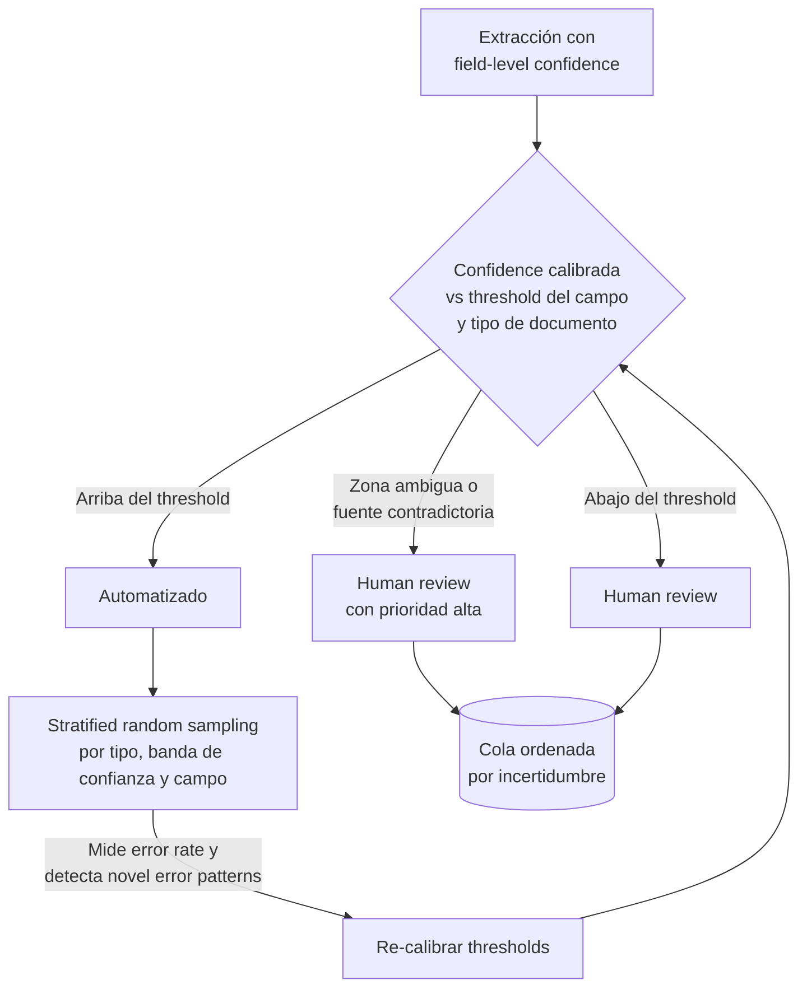

## Explícamelo como si tuviera 5 años

Imagina una escuela con 1,000 alumnos donde el director presume: *"¡el 97% de los alumnos aprueba matemáticas!"*. Suena increíble, así que propone **dejar de revisar exámenes** y que los apruebe una máquina.

Pero una maestra curiosa separa los resultados por salón:

- Los 900 alumnos del turno matutino: casi todos aprueban.
- Los 30 alumnos que llegaron de otro país (y no entienden bien el idioma del examen): **solo la mitad aprueba**.
- Los 20 que hicieron el examen a mano con letra difícil de leer: también les va muy mal.

El 97% era real… pero **escondía** a los salones donde todo sale mal, porque eran pocos alumnos comparados con el turno matutino.

Además, la máquina dice cosas como *"estoy 90% segura de esta calificación"*. Pero la maestra comprueba con exámenes que ya calificó a mano y descubre que cuando la máquina dice "90% segura" en sumas, acierta 94 de cada 100; cuando dice "90% segura" en fracciones, solo acierta 82. **El mismo "90%" significa cosas distintas.**

¿Qué hace una escuela sensata?

- **Revisar por salón y por tema** (`accuracy by document type and field`), no solo el promedio general.
- **Comprobar qué significa de verdad el "estoy segura"** de la máquina usando exámenes ya calificados a mano (`calibration` con `labeled validation sets`).
- **Seguir revisando al azar algunos exámenes que la máquina calificó "muy segura"**, de todos los salones (`stratified random sampling`), por si aparece un error nuevo.
- **Dar a los pocos maestros revisores primero los exámenes más dudosos** (`reviewer capacity prioritization`), no repartir parejo.

> [!note] En una frase
> Antes de quitar `human review` en un sistema de extracción, valida la accuracy **por tipo de documento y por campo** (el agregado engaña), **calibra** los `confidence scores` por campo con `labeled validation sets`, sigue **muestreando de forma estratificada** incluso las extracciones de alta confianza, y manda la capacidad limitada de revisores a los ítems **más inciertos** primero.

## Argumento central

> `Human review` es la **red de seguridad** de los sistemas de extracción y clasificación. El reto de fondo es **asignar una capacidad de revisión limitada** para maximizar la accuracy minimizando el costo. Para hacerlo bien hay que entender tres cosas: que las **métricas agregadas engañan** (97% global puede esconder 40%+ de error en segmentos concretos), que los **`confidence scores` crudos no están calibrados**, y que hay que **seguir midiendo con `stratified random sampling`** también lo que ya se automatizó.



## Ideas clave (Conclusiones)

### 1. `The Aggregate Metrics Trap` — el promedio esconde las fallas

- Es **la idea errónea más peligrosa** en sistemas de extracción en producción: decidir con un **porcentaje global** sin mirar el desglose.
- El agregado se ve excelente porque **el tipo de documento dominante en volumen** (ej. facturas estándar) "jala" el promedio hacia arriba.
- Los errores de **alto impacto** suelen estar justo en los segmentos minoritarios (recibos manuscritos, facturas internacionales, documentos de compliance escaneados) — y quedan **invisibles**.
- Regla de la guía: **valida accuracy por tipo de documento Y por segmento de campo antes de automatizar. Nunca decidas automatizar con métricas agregadas solas.**

> [!example] Evidencia — tabla de la guía
> | Document Type | Date Accuracy | Amount Accuracy | Name Accuracy |
> |---|---|---|---|
> | Standard invoices | 99.5% | 98.2% | 97.8% |
> | Handwritten receipts | 60.1% | 55.3% | 71.2% |
> | Scanned PDFs | 72.4% | 69.8% | 80.1% |
> | International formats | 45.2% | 52.1% | 63.4% |
> | **Aggregate** | **97.0%** | **96.1%** | **95.8%** |
>
> El 97% en fechas convive con un **45%** en documentos internacionales.

> [!note] Analogía mental
> Es como medir la temperatura promedio de un hospital: 37 °C "en promedio" no te dice que en el cuarto 12 hay un paciente con 40 °C de fiebre.

> [!important] Por dos ejes, no uno
> El desglose es **por tipo de documento Y por campo**. Un tipo de documento puede ir bien en nombres (71%) y fatal en montos (55%); un campo puede ir bien en un tipo y mal en otro.

### 2. `Stratified Random Sampling` — seguir midiendo lo automatizado

- La verificación continua toma **muestras representativas de cada estrato** (`stratum`): tipo de documento, banda de confianza (`confidence band`), tipo de campo.
- **Insight crítico:** hay que muestrear **las extracciones de alta confianza**, no solo las de baja.
  - Las de baja confianza **ya van** a `human review`.
  - Las de alta confianza se **automatizan** → nadie las ve.
  - Los **novel error patterns** que afectan a las de alta confianza **solo salen a la luz** con este muestreo.
- **Doble propósito:**
  1. **Medición continua de accuracy** — confirmar que cada segmento mantiene la tasa validada.
  2. **Detección de `novel error patterns`** — fallas nuevas que no existían en el validation set original.

> [!warning] Riesgo sin sampling
> El sistema puede desarrollar **errores sistemáticos en formatos nuevos de documento** sin que nadie lo detecte, hasta que **fallan los procesos de negocio downstream**.

> [!note] Analogía mental
> Un restaurante que solo inspecciona los platos que el cocinero dice "no me salió bien" nunca descubrirá que el horno nuevo quema todo lo que el cocinero cree perfecto. Hay que probar al azar también los platos "perfectos".

### 3. `Field-Level Confidence Calibration` — qué significa de verdad un 0.95

- El modelo debe emitir un **`confidence score` por campo** (no uno por documento).
- Problema: los **`confidence scores` crudos no están calibrados**. Un 0.95 da información **relativa**, no **absoluta**: el mismo valor puede equivaler a 94% de accuracy real en un campo y 82% en otro.
- **Calibración:** se requiere un **`labeled validation set`** (ground truth). Se corre el modelo sobre documentos con extracción correcta conocida y se construyen **calibration curves**: confianza reportada → accuracy real.
- Con eso se fijan **thresholds calibrados por campo (y por tipo de documento)**.

> [!example] Evidencia — salida de la guía con confianza por campo
> ```json
> {
>   "vendorName": { "value": "Acme Corp", "confidence": 0.98 },
>   "invoiceDate": { "value": "2024-03-15", "confidence": 0.95 },
>   "totalAmount": { "value": "$1,247.83", "confidence": 0.72 },
>   "lineItems": { "value": [...], "confidence": 0.61 }
> }
> ```
> Hallazgo de calibración citado por la guía: *"When the model reports 0.90 confidence on date fields, it's actually correct 94% of the time. When it reports 0.90 on amount fields, it's actually correct 82% of the time."*

**Routing con thresholds calibrados:**

| Zona | Qué pasa |
|---|---|
| Arriba del threshold calibrado | Automatizado (**con** `stratified sampling`) |
| Abajo del threshold calibrado | `Human review` |
| Zona ambigua | `Human review` **priorizado** |

> [!note] Conexión con 5.2
> La guía oficial (Sample Question 3, escenario Customer Support) descarta usar una **self-reported confidence** del LLM para escalar precisamente porque **está mal calibrada**. Aquí la lección es la misma: un número de confianza solo sirve **después** de calibrarlo contra datos etiquetados.

### 4. `Reviewer Capacity Prioritisation` — los revisores son escasos

- Principio: **manda primero a revisión los ítems de mayor incertidumbre**; no repartas la capacidad parejo.
- Qué priorizar:
  - Campos con **baja confianza** del modelo.
  - Extracciones de documentos fuente **ambiguos o contradictorios**.
  - **Tipos de documento con mala accuracy histórica**.
  - Campos donde el modelo expresa **incertidumbre** (varias interpretaciones posibles).
- **Priorización dinámica, no estática:** conforme llegan documentos, la cola se **reordena por incertidumbre**. Cada revisor recibe **el ítem restante más incierto**, no el siguiente en orden cronológico.

> [!warning] Anti-pattern
> Repartir la revisión de forma pareja **desperdicia tiempo** revisando extracciones de alta confianza que el modelo ya hace bien, y deja **sin capacidad** a los ítems inciertos que sí necesitan juicio humano.

> [!note] Analogía mental
> Una sala de urgencias hace **triage**: no atiende por orden de llegada, sino al más grave primero — y si entra alguien más grave, se reordena la fila.

### 5. `Validation Before Automation` — la secuencia obligatoria

Cada paso previene un modo de falla específico:

1. **Medir accuracy por tipo de documento y segmento de campo** (no agregado) → evita la trampa del promedio.
2. **Calibrar los `confidence scores`** con `labeled validation sets` → evita confiar en scores crudos.
3. **Fijar thresholds calibrados** para automatización vs. `human review`.
4. **Implementar `stratified random sampling`** para verificación continua → detecta drift y novel error patterns.
5. **Solo entonces** reducir `human review` en los segmentos **consistentemente precisos**.

> [!important] La trampa principal
> **Saltar directo al paso 5 basándose en métricas agregadas** es el error central del tema.

### Mapa rápido: problema → práctica

| Problema | Práctica correcta |
|---|---|
| 97% global esconde 40%+ de error en ciertos tipos | Accuracy **por tipo de documento Y campo** |
| Un 0.90 significa cosas distintas según el campo | **Calibración** con `labeled validation sets` → thresholds por campo |
| Errores nuevos en lo automatizado pasan desapercibidos | **`Stratified random sampling`** incluyendo alta confianza |
| Revisores gastados en ítems fáciles | **Cola dinámica por incertidumbre** |
| Automatizar demasiado pronto | Seguir la **secuencia de 5 pasos** |

## Trampas de examen

> [!warning] Trampa 1 — Usar accuracy agregada para justificar automatizar todo lo de alta confianza
> **El error:** "tenemos 97% global, automaticemos todo lo que tenga confianza > 95%". **Por qué falla:** las métricas agregadas esconden el desempeño por tipo; un 97% global puede ocultar ~40% de accuracy en tipos concretos (ej. internacionales al 45%). **Lo correcto:** validar por tipo de documento **y** segmento de campo, y calibrar los scores antes de automatizar. *(Es exactamente la pregunta del Practice Scenario de la guía: la respuesta correcta combina "aggregate accuracy may mask poor performance" + "confidence scores need calibration against labelled validation sets"; los distractores eran "subir el threshold a 99%", "reentrenar porque el modelo se vuelve sobreconfiado" y "toda extracción requiere revisión siempre".)*

> [!warning] Trampa 2 — Muestrear solo las extracciones de baja confianza
> **El error:** pensar que el sampling es para lo dudoso. **Por qué falla:** lo de baja confianza **ya** pasa por `human review`; lo de alta confianza está automatizado, y los `novel error patterns` que lo afectan **solo** aparecen con `stratified random sampling`. **Lo correcto:** muestrear de **cada estrato**, incluidas las bandas de alta confianza.

> [!warning] Trampa 3 — Usar los `confidence scores` crudos del modelo sin calibrar
> **El error:** poner un threshold único (ej. 0.90) y confiar en él para todos los campos. **Por qué falla:** los scores crudos no están calibrados: 0.90 en fechas ≈ 94% real, 0.90 en montos ≈ 82% real. **Lo correcto:** calibrar con `labeled validation sets` y fijar thresholds **por campo** (y por tipo de documento). Subir el threshold (95% → 99%) **sin calibrar** no arregla nada.

> [!warning] Trampa 4 — Repartir la capacidad de revisión de forma pareja
> **El error:** revisar un % igual de todo, o revisar en orden cronológico. **Por qué falla:** desperdicia revisores en ítems de alta confianza que el modelo ya maneja bien. **Lo correcto:** priorizar dinámicamente los ítems de **mayor incertidumbre** (baja confianza, fuentes ambiguas/contradictorias, tipos con mala accuracy histórica).

> [!info] Pregunta de muestra oficial
> `examguide.pdf` no tiene una Sample Question 1:1 para el Task Statement 5.5. La más cercana es la **Sample Question 3** (Task Statement 5.2, escalation), cuyo distractor B ("self-reported confidence score") falla porque la confianza autodeclarada del LLM está mal calibrada — el mismo principio de la Trampa 3. [[4 test]] usa preguntas propias sobre el "Knowledge of" / "Skills in" de la Task Statement 5.5.

---
> [!tip] Sigue con este tema
> Repasa con [[3 cuestionario]], aplícalo en código en [[2 example]], y evalúate con [[4 test]].
