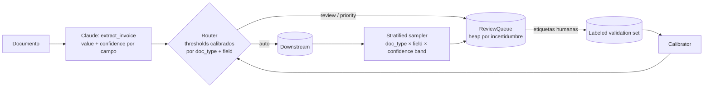

Aplicación práctica de [[1 resumen]] — un **review router calibrado** en Python para un pipeline de extracción de facturas con Claude: extracción con `field-level confidence` vía `tool use`, accuracy segmentada por tipo de documento y campo, calibración con un `labeled validation set`, routing por thresholds calibrados, `stratified random sampling` (incluyendo alta confianza) y una cola de revisión dinámica ordenada por incertidumbre.

## Escenario

Una empresa procesa ~10,000 documentos al mes: facturas estándar (la gran mayoría), recibos manuscritos, PDFs escaneados con OCR malo y facturas internacionales. Hoy **todo** pasa por revisión humana y el equipo quiere reducir costos. El dashboard dice **97% de accuracy** y alguien propone: *"automaticemos todo lo que tenga confianza > 0.95"*.

Vamos a aplicar **todo** el resumen siguiendo la secuencia de `Validation Before Automation`:

1. Extraer con `confidence score` **por campo** (y señal de ambigüedad/contradicción).
2. Medir accuracy **por tipo de documento Y campo** (no agregado).
3. **Calibrar** los scores con un `labeled validation set` → thresholds por segmento.
4. Enrutar: automatizado / `human review` / `human review` priorizado.
5. `Stratified random sampling` sobre lo automatizado (incluida la banda de alta confianza).
6. Cola de revisión **dinámica** por incertidumbre.
7. Solo entonces, reducir `human review` en los segmentos que lo merecen.



## Paso 1 — Extracción con `field-level confidence`

Pedimos a Claude la salida estructurada mediante una tool con `input_schema` y `tool_choice` forzado, de modo que **cada campo** traiga su `value`, su `confidence` y una bandera de `ambiguous` (cuando el documento fuente es ambiguo o contradictorio, ej. dos totales distintos). La confianza es **por campo**, no una sola por documento: es lo que permite calibrar y enrutar campo por campo.

```python
import anthropic

client = anthropic.Anthropic()  # usa ANTHROPIC_API_KEY del entorno
MODEL = "claude-sonnet-5-5"

FIELDS = ["vendorName", "invoiceDate", "totalAmount", "lineItems"]


def _field_schema(value_schema: dict) -> dict:
    return {
        "type": "object",
        "properties": {
            "value": value_schema,
            "confidence": {
                "type": "number",
                "minimum": 0,
                "maximum": 1,
                "description": "Your confidence that this value is exactly correct.",
            },
            "ambiguous": {
                "type": "boolean",
                "description": "True if the source is ambiguous or contradictory for this field "
                "(e.g. two different totals, illegible handwriting, multiple plausible dates).",
            },
            "alternatives": {
                "type": "array",
                "items": {"type": "string"},
                "description": "Other plausible readings when ambiguous is true.",
            },
        },
        "required": ["value", "confidence", "ambiguous"],
    }


EXTRACT_TOOL = {
    "name": "extract_invoice",
    "description": "Record the fields extracted from the document, each with a confidence score.",
    "input_schema": {
        "type": "object",
        "properties": {
            "vendorName": _field_schema({"type": ["string", "null"]}),
            "invoiceDate": _field_schema({"type": ["string", "null"], "description": "ISO 8601"}),
            "totalAmount": _field_schema({"type": ["string", "null"]}),
            "lineItems": _field_schema({"type": "array", "items": {"type": "object"}}),
        },
        "required": FIELDS,
    },
}


def extract(document_text: str) -> dict:
    response = client.messages.create(
        model=MODEL,
        max_tokens=2048,
        tools=[EXTRACT_TOOL],
        tool_choice={"type": "tool", "name": "extract_invoice"},
        messages=[{"role": "user", "content": f"Extract the invoice fields.\n\n<document>\n{document_text}\n</document>"}],
    )
    tool_use = next(b for b in response.content if b.type == "tool_use")
    return tool_use.input  # {"vendorName": {"value": ..., "confidence": 0.98, "ambiguous": False}, ...}
```

> [!warning] Trampa en código — el `confidence` que devuelve el modelo es un score **crudo**
> Lo que sale de `extract()` **no** es una probabilidad de acierto. Es información **relativa** ("este campo me parece más seguro que aquel"). Usarlo directo para automatizar es la Trampa 3 del resumen. Por eso los pasos 3 y 4 existen.

## Paso 2 — Accuracy por tipo de documento **y** campo

Con un `labeled validation set` (documentos con la extracción correcta conocida, `ground truth`) corremos el extractor y guardamos **una fila por campo**. Luego medimos accuracy por `(doc_type, field)`, además del agregado — para ver qué esconde.

```python
from collections import defaultdict
from dataclasses import dataclass


@dataclass
class FieldResult:
    doc_id: str
    doc_type: str      # "standard_invoice" | "handwritten_receipt" | "scanned_pdf" | "international"
    field: str
    predicted: object
    expected: object   # ground truth del labeled validation set
    confidence: float  # score crudo del modelo
    ambiguous: bool

    @property
    def correct(self) -> bool:
        return normalize(self.predicted) == normalize(self.expected)


def normalize(v):
    return v.strip().lower() if isinstance(v, str) else v


def build_results(validation_set: list[dict]) -> list[FieldResult]:
    """validation_set: [{"doc_id", "doc_type", "text", "labels": {field: expected}}]"""
    rows = []
    for doc in validation_set:
        out = extract(doc["text"])
        for f in FIELDS:
            rows.append(FieldResult(doc["doc_id"], doc["doc_type"], f, out[f]["value"],
                                    doc["labels"][f], out[f]["confidence"], out[f]["ambiguous"]))
    return rows


def accuracy_by_segment(rows: list[FieldResult]) -> dict[tuple[str, str], tuple[float, int]]:
    buckets = defaultdict(list)
    for r in rows:
        buckets[(r.doc_type, r.field)].append(r.correct)
    return {seg: (sum(v) / len(v), len(v)) for seg, v in buckets.items()}


def report(rows: list[FieldResult]) -> None:
    overall = sum(r.correct for r in rows) / len(rows)
    print(f"AGGREGATE accuracy: {overall:.1%}  <-- no decidas con este número")
    for (doc_type, field), (acc, n) in sorted(accuracy_by_segment(rows).items(), key=lambda kv: kv[1][0]):
        flag = "  ⚠️" if acc < 0.95 else ""
        print(f"{doc_type:22} {field:12} {acc:6.1%}  (n={n}){flag}")
```

Salida típica (mismo patrón que la tabla de la guía):

```text
AGGREGATE accuracy: 97.0%  <-- no decidas con este número
international          invoiceDate   45.2%  (n=62)  ⚠️
international          totalAmount   52.1%  (n=62)  ⚠️
handwritten_receipt    totalAmount   55.3%  (n=48)  ⚠️
handwritten_receipt    invoiceDate   60.1%  (n=48)  ⚠️
scanned_pdf            totalAmount   69.8%  (n=55)  ⚠️
...
standard_invoice       invoiceDate   99.5%  (n=1835)
```

> [!warning] Trampa en código — decidir con el agregado
> ```python
> # ❌ Forma ingenua (Trampa 1)
> if sum(r.correct for r in rows) / len(rows) >= 0.97:
>     AUTOMATE_ALL_HIGH_CONFIDENCE = True
> ```
> El 97% lo dominan las 1,835 facturas estándar. Este `if` automatiza también los internacionales al 45%. La decisión **siempre** se toma por segmento `(doc_type, field)`.

> [!tip] Estratifica también el validation set
> Fíjate en los `n`: si el validation set se armó "al azar" sobre el volumen real, los segmentos minoritarios tienen muy pocas muestras. Asegura un mínimo por segmento (aquí `MIN_SUPPORT`, paso 3) para que la accuracy de cada uno sea confiable.

## Paso 3 — Calibración: confianza cruda → accuracy real

Construimos una **calibration curve** por segmento: agrupamos por bandas de confianza y medimos qué fracción es realmente correcta. Después elegimos, para cada `(doc_type, field)`, el **threshold más bajo** a partir del cual la accuracy real de lo que quede arriba alcanza el objetivo. Si ningún threshold lo logra con soporte suficiente, el segmento **no se automatiza**.

```python
import bisect

TARGET_ACCURACY = 0.98   # accuracy exigida a lo que se automatiza
MIN_SUPPORT = 30         # mínimo de ejemplos arriba del threshold para confiar en la medición
BANDS = [0.0, 0.5, 0.7, 0.8, 0.9, 0.95, 1.01]


def calibration_curve(rows: list[FieldResult]) -> list[tuple[str, float, int]]:
    """Para un segmento: [(banda, accuracy real, n)]."""
    curve = []
    for lo, hi in zip(BANDS, BANDS[1:]):
        band = [r for r in rows if lo <= r.confidence < hi]
        if band:
            curve.append((f"[{lo:.2f}, {hi:.2f})", sum(r.correct for r in band) / len(band), len(band)))
    return curve


def calibrate_threshold(rows: list[FieldResult]) -> float | None:
    """Threshold mínimo t tal que accuracy(conf >= t) >= TARGET_ACCURACY con soporte suficiente."""
    ranked = sorted(rows, key=lambda r: r.confidence, reverse=True)
    best, correct = None, 0
    for i, r in enumerate(ranked, start=1):
        correct += r.correct
        if i >= MIN_SUPPORT and correct / i >= TARGET_ACCURACY:
            best = r.confidence          # seguimos bajando mientras se sostenga el objetivo
    return best                          # None => este segmento NO se automatiza


def calibrate(rows: list[FieldResult]) -> dict[tuple[str, str], float | None]:
    by_seg = defaultdict(list)
    for r in rows:
        if not r.ambiguous:              # lo ambiguo nunca se automatiza; no sesga el threshold
            by_seg[(r.doc_type, r.field)].append(r)
    return {seg: calibrate_threshold(seg_rows) for seg, seg_rows in by_seg.items()}
```

Lo que revela la curva (el ejemplo de la guía):

```text
standard_invoice / invoiceDate   [0.90, 0.95)  actual accuracy 94%
standard_invoice / totalAmount   [0.90, 0.95)  actual accuracy 82%
```

El **mismo 0.90** significa 94% en fechas y 82% en montos → thresholds distintos por campo:

```python
THRESHOLDS = calibrate(build_results(validation_set))
# {("standard_invoice", "invoiceDate"): 0.91,
#  ("standard_invoice", "totalAmount"): 0.97,
#  ("international", "invoiceDate"): None,    # nunca alcanza 98% -> siempre a revisión
#  ...}
```

> [!warning] Trampa en código — un threshold global sobre el score crudo
> ```python
> # ❌ Forma ingenua (Trampas 1 y 3)
> AUTO_THRESHOLD = 0.95
> if field["confidence"] > AUTO_THRESHOLD:
>     send_downstream(field)
> ```
> Un solo número para todos los campos y tipos asume que 0.95 "significa" lo mismo en todas partes. Y la "solución" típica de subirlo a 0.99 tampoco arregla nada: sigue sin calibrar y sigue ignorando que en `international` el modelo puede estar muy seguro y equivocado.

## Paso 4 — Routing por thresholds calibrados

Tres destinos, tal como en el resumen: **auto** (arriba del threshold calibrado), **review** (abajo), **priority review** (zona ambigua: fuente contradictoria/ambigua, o confianza justo en el borde del threshold). Un segmento sin threshold calibrado (`None`) **siempre** va a revisión.

```python
from enum import Enum

AMBIGUOUS_MARGIN = 0.05  # banda alrededor del threshold que tratamos como zona ambigua


class Route(str, Enum):
    AUTO = "auto"
    REVIEW = "review"
    PRIORITY_REVIEW = "priority_review"


def route_field(doc_type: str, field: str, extraction: dict) -> Route:
    threshold = THRESHOLDS.get((doc_type, field))
    conf = extraction["confidence"]

    if extraction["ambiguous"]:
        return Route.PRIORITY_REVIEW                 # fuente ambigua/contradictoria
    if threshold is None:
        return Route.REVIEW                          # segmento no validado para automatizar
    if conf >= threshold + AMBIGUOUS_MARGIN:
        return Route.AUTO
    if conf >= threshold - AMBIGUOUS_MARGIN:
        return Route.PRIORITY_REVIEW                 # en el borde: zona ambigua
    return Route.REVIEW
```

## Paso 5 — `Stratified random sampling` (incluida la alta confianza)

Lo que se enruta a `AUTO` nadie lo ve. Para **medir el error rate real** y **detectar `novel error patterns`** (ej. un proveedor nuevo con otro formato de fecha), muestreamos de **cada estrato** `(doc_type, field, confidence band)` — también de la banda más alta — y mandamos esas muestras a revisión humana. Las etiquetas resultantes alimentan de nuevo el validation set y la recalibración.

```python
import random

SAMPLE_RATE = 0.02     # proporcional al volumen del estrato
MIN_PER_STRATUM = 5    # piso para que los estratos pequeños no queden sin muestra


def confidence_band(conf: float) -> str:
    i = bisect.bisect_right(BANDS, conf) - 1
    return f"[{BANDS[i]:.2f}, {BANDS[i + 1]:.2f})"


def stratified_sample(auto_items: list[dict], rng: random.Random) -> list[dict]:
    """auto_items: extracciones enrutadas a AUTO en el periodo, con doc_type, field, confidence."""
    strata = defaultdict(list)
    for item in auto_items:
        strata[(item["doc_type"], item["field"], confidence_band(item["confidence"]))].append(item)

    sample = []
    for key, items in strata.items():
        k = min(len(items), max(MIN_PER_STRATUM, round(len(items) * SAMPLE_RATE)))
        sample.extend(rng.sample(items, k))
    return sample
```

> [!warning] Trampa en código — muestrear solo lo de baja confianza
> ```python
> # ❌ Forma ingenua (Trampa 2)
> sample = [i for i in all_items if i["confidence"] < 0.7]
> ```
> Esos ítems **ya** van a `human review` por el router: el muestreo no aporta nada nuevo. Y los errores que importan — los que pasan con confianza alta directo a downstream — nunca se ven. El muestreo existe precisamente para la banda alta.

Con las etiquetas del muestreo, comparamos el error rate de cada estrato contra el validado. Si un segmento se degrada, **se retira de la automatización** hasta recalibrar:

```python
def monitor(sampled_results: list[FieldResult], validated: dict, tolerance: float = 0.02) -> list[tuple]:
    alerts = []
    for seg, (acc, n) in accuracy_by_segment(sampled_results).items():
        expected = validated.get(seg, (None,))[0]
        if expected is not None and acc < expected - tolerance:
            THRESHOLDS[seg] = None   # vuelve a human review hasta recalibrar
            alerts.append((seg, expected, acc, n))
    return alerts                    # posibles novel error patterns: revisar los errores a mano
```

## Paso 6 — Cola de revisión dinámica por incertidumbre

La capacidad de los revisores es limitada. En vez de repartir parejo o atender por orden de llegada, usamos un **heap** ordenado por incertidumbre: cada revisor toma **el ítem restante más incierto**, y la cola se reordena sola conforme llegan extracciones nuevas.

```python
import heapq
import itertools

POOR_HISTORY = 0.80  # segmentos con accuracy histórica por debajo de esto suben de prioridad


def uncertainty(item: dict, route: Route, seg_accuracy: dict) -> float:
    score = 1.0 - item["confidence"]                                  # baja confianza del modelo
    if item["ambiguous"]:
        score += 0.5                                                  # fuente ambigua/contradictoria
        score += 0.1 * len(item.get("alternatives", []))             # varias interpretaciones
    hist = seg_accuracy.get((item["doc_type"], item["field"]), (1.0, 0))[0]
    if hist < POOR_HISTORY:
        score += POOR_HISTORY - hist                                  # mala accuracy histórica
    if route is Route.PRIORITY_REVIEW:
        score += 0.25
    return score


class ReviewQueue:
    def __init__(self, seg_accuracy: dict):
        self._heap: list = []
        self._counter = itertools.count()
        self._seg_accuracy = seg_accuracy

    def push(self, item: dict, route: Route) -> None:
        # heapq es min-heap: negamos para que salga primero la MAYOR incertidumbre
        priority = -uncertainty(item, route, self._seg_accuracy)
        heapq.heappush(self._heap, (priority, next(self._counter), item))

    def next_for_reviewer(self) -> dict | None:
        return heapq.heappop(self._heap)[2] if self._heap else None
```

> [!warning] Trampa en código — repartir parejo / orden cronológico
> ```python
> # ❌ Forma ingenua (Trampa 4)
> review_queue = collections.deque()
> for item in all_items:
>     if random.random() < 0.10:      # "revisamos el 10% de todo"
>         review_queue.append(item)   # y se atiende FIFO
> ```
> El 90% de ese 10% son facturas estándar que el modelo ya clava; los recibos manuscritos ambiguos esperan detrás de ellas o ni siquiera entran. La cola por incertidumbre pone la atención humana donde **agrega más valor**.

## Paso 7 — Pipeline completo y la decisión de reducir `human review`

Juntamos todo. Fíjate en el orden: la decisión de automatizar un segmento es **lo último**, y se toma **por segmento** con los datos de los pasos anteriores.

```python
def process_batch(documents: list[dict], queue: ReviewQueue) -> list[dict]:
    auto_items = []
    for doc in documents:
        extraction = extract(doc["text"])
        for f in FIELDS:
            item = {"doc_id": doc["doc_id"], "doc_type": doc["doc_type"], "field": f, **extraction[f]}
            route = route_field(doc["doc_type"], f, extraction[f])
            if route is Route.AUTO:
                auto_items.append(item)
            else:
                queue.push(item, route)
    return auto_items


def automation_report(seg_accuracy: dict) -> None:
    """Paso 5 de la secuencia: solo reducimos review donde TODO lo anterior se cumple."""
    for seg, (acc, n) in sorted(seg_accuracy.items()):
        threshold = THRESHOLDS.get(seg)
        ok = threshold is not None and acc >= TARGET_ACCURACY and n >= MIN_SUPPORT
        print(f"{seg}: {'reduce review (auto + sampling)' if ok else 'keep human review'}")


# --- Secuencia de Validation Before Automation ---
rng = random.Random(42)
val_rows = build_results(validation_set)                 # 1. medir por segmento
report(val_rows)
SEG_ACCURACY = accuracy_by_segment(val_rows)
THRESHOLDS = calibrate(val_rows)                         # 2-3. calibrar y fijar thresholds
queue = ReviewQueue(SEG_ACCURACY)

auto_items = process_batch(incoming_documents, queue)    # routing + cola dinámica
for item in stratified_sample(auto_items, rng):          # 4. sampling continuo (alta confianza incluida)
    queue.push(item, Route.REVIEW)

automation_report(SEG_ACCURACY)                          # 5. solo entonces reducir review
```

> [!note] Cómo se conecta con el resumen
> | Concepto del [[1 resumen]] | Dónde vive en el código |
> |---|---|
> | `Aggregate Metrics Trap` | `report()` / `accuracy_by_segment()` (paso 2) |
> | `Field-level confidence` | `EXTRACT_TOOL` con `confidence` por campo (paso 1) |
> | `Calibration` con `labeled validation sets` | `calibration_curve()` / `calibrate()` (paso 3) |
> | Routing auto / review / ambiguo | `route_field()` (paso 4) |
> | `Stratified random sampling` + `novel error patterns` | `stratified_sample()` / `monitor()` (paso 5) |
> | `Reviewer capacity prioritisation` dinámica | `ReviewQueue` (paso 6) |
> | `Validation Before Automation` | orden del pipeline y `automation_report()` (paso 7) |

---
> [!tip] Sigue con este tema
> Vuelve a la teoría en [[1 resumen]], repasa con [[3 cuestionario]] y evalúate con [[4 test]].
